# ⚡ Awesome Decentralized Chat &amp; P2P Swarm Messaging 💬

> 🌐 A curated directory of battle-tested SaaS products, serverless protocols, peer-to-peer (P2P) swarms, onion-routed messengers, and offline mesh networks for private, censorship-resistant communication.

<!-- Badges Header -->

  
  
  
  
  
  

**Decentralized Chat &amp; P2P Swarm Messaging** | **Onion Routing &amp; Tor** | **Matrix Homeservers** | **Bluetooth &amp; LoRa Mesh Networks** | **Zero-Metadata Communication**

---

## 📖 Introduction &amp; Ecosystem Scope

This repository provides an authoritative, community-vetted guide to the **Decentralized Chat &amp; P2P Swarm Messaging** landscape. Modern instant messaging frequently forces users to sacrifice privacy, security, and digital sovereignty to centralized tech silos. In contrast, the architectures documented here operate with **zero central points of failure**, utilizing:

- 🛡️ **Federated Architectures**: Open protocols (e.g., Matrix) that allow self-hosted homeservers to communicate globally via standard federation.
- 🧅 **Onion Routing &amp; Distributed Swarms**: Multi-hop encrypted routing (Session, Tor, I2P) where nodes never learn both origin and destination metadata.
- 📶 **Serverless &amp; Offline Mesh**: Direct device-to-device (P2P) connections and local radio/Bluetooth meshes (Meshtastic, Briar, Berty) capable of running through internet outages, emergency blackouts, and state-sponsored censorship.
- 🔒 **Zero-Identifier Protocols**: Radically private designs (SimpleX) eliminating global identifiers entirely by using unidirectional queue routers.

---

## 📑 Table of Contents

- [📊 Sector Overview &amp; Market Dynamics](#-sector-overview--market-dynamics)
- [💼 SaaS &amp; Hosted Platforms](#-saas--hosted-platforms)
- [💻 Open-Source GitHub Projects](#-open-source-github-projects)
- [🤝 How to Contribute](#-how-to-contribute)
- [⭐ Star History](#-star-history)
- [💖 Support &amp; Sponsorship](#-support--sponsorship)
- [⚖️ Disclaimer](#-disclaimer)

---

## 📊 Sector Overview &amp; Market Dynamics

The global decentralized and Web3 messaging market is estimated between **$85 million and $1.5 billion** (and projected to expand toward **$15 billion to $34 billion** by the mid-2030s at an estimated compound annual growth rate of ~36%–44% CAGR). 

The sector is currently **moderately fragmented**. Unlike legacy consumer instant messaging where monopolies dominate network effects, the decentralized messaging ecosystem thrives on a diverse, rapidly evolving landscape of open cryptographic protocols (Matrix, Nostr, Pear/Holepunch, Tox, Tor/I2P onion services, and LoRa mesh). Low barriers to entry for open-source protocol developers foster continuous innovation, while standards like Matrix and SimpleX are steadily consolidating enterprise, government, and activist adoption for sovereign communications.

---

## 💼 SaaS &amp; Hosted Platforms

*Commercial-grade hosted services and managed decentralized platforms sorted by company size (valuation, strategic funding, or annual recurring revenue).*

| 🏢 Platform | 💰 Company Size (Valuation / Funding) | 🏷️ Starting Tier Pricing | 🎁 Free Tier Limits | ⚙️ Architecture &amp; Key Focus |
| :--- | :--- | :--- | :--- | :--- |
| **[Keet (Holepunch)](https://keet.io/)** | **~$10M–$100M** backing (Backed by Tether &amp; Bitfinex; $10M initial funding + up to $100M ecosystem capital commitment; Tether parent valued at ~$500B) | **$0 / month** (100% free serverless P2P model; optional P2P Lightning/USDT micropayments for dev integrations) | **Free forever with no artificial limits**: Unlimited direct peer-to-peer 1-on-1 and group chat, HD calls, and direct device-to-device file transfer without central server bandwidth caps | Pure serverless peer-to-peer (P2P) desktop/mobile client built on Pear Runtime; zero intermediary servers or cloud storage. |
| **[Element (Matrix)](https://element.io/)** | **~$50M+** total funding raised ($30M Series B led by Protocol Labs, Automattic, Notion Capital; revenue ~$5M–$10M ARR) | **$5.00 / user / month** (Element Cloud Starter / Business managed hosting; custom quotes for Enterprise starting at 100+ seats) | **Free forever plan (Community &amp; Public Matrix.org)**: Free self-hosting for up to 100 users via Element Server Suite Community FOSS distribution; free public accounts on `matrix.org` homeserver capped at 10 MB per file attachment and 100 MB data usage / 24 hrs (500 MB / 28 days) | Federated homeserver architecture (Matrix protocol); enterprise secure border gateways, air-gapped defense/government deployments. |
| **[Session](https://getsession.org/)** | **~$1M–$5M** crypto market cap &amp; grant funding (Stewarded by non-profit Session Technology Foundation / Oxen; funded via donations, node rewards, and token utility) | **$2.99 / user / month** (Session Pro yearly subscription, or $4.99/mo billed monthly) | **Free forever plan**: Unlimited standard E2E encrypted messaging, voice calls, and group chats up to 100 members; file attachments capped at 10 MB per file, 2-week message TTL on decentralized storage nodes; no account info or phone number needed | Onion-routed, service-node decentralized network with swarm storage and zero metadata collection. |

---

## 💻 Open-Source GitHub Projects

*Active open-source repositories sorted in descending order by GitHub stargazers count.*

### 1. 🛡️ [SimpleX Chat](https://github.com/simplex-chat/simplex-chat) 
- **Architecture**: Asynchronous unidirectional message queues with zero user identifiers.
- **Highlights**: The most radical privacy design in modern communications—no user identifiers, phone numbers, or public keys exposed to relays. Operates redundant simplex queues for each contact and supports routing over Tor and SOCKS5 to defend against network traffic analysis.
- **Best for**: Activists, journalists, and privacy-conscious users requiring absolute metadata anonymity.

---

### 2. 🌐 [Element Web](https://github.com/element-hq/element-web) 
- **Architecture**: Decentralized federated Matrix web and desktop client.
- **Highlights**: The flagship open-source client implementing the Matrix standard. Features end-to-end encrypted group rooms, VoIP/video conferencing with Element Call, cross-signing key verification, space hierarchies, and third-party bridging (Slack, Discord, Telegram).
- **Best for**: Organizations, communities, and enterprises seeking a sovereign, self-hosted alternative to Slack and Microsoft Teams.

---

### 3. 💬 [Tinode](https://github.com/tinode/chat) 
- **Architecture**: Pure Go-based instant messaging server with gRPC, WebSockets, and long polling.
- **Highlights**: High-performance, self-hosted instant messaging platform designed to replace proprietary chat services. Offers full mobile SDKs (iOS, Android), native push notifications, chatbot integration, message caching, and lightweight resource utilization.
- **Best for**: Developers integrating scalable, self-hosted instant messaging into web and mobile applications.

---

### 4. ⚡ [Nostr Protocol](https://github.com/nostr-protocol/nostr) 
- **Architecture**: Ultra-lightweight decentralized protocol based on cryptographic keypairs and dumb WebSocket relays.
- **Highlights**: Decentralized social and direct-messaging standard ("Notes and Other Stuff Transmitted by Relays"). Relies on schnorr signatures, immutable event distribution, and NIP-04/NIP-17 direct encrypted messages, creating an indestructible censorship-resistant communication network.
- **Best for**: Censorship-resistant public posting, microblogging, and sovereign peer communication.

---

### 5. 🏛️ [Synapse (Matrix Homeserver)](https://github.com/matrix-org/synapse) 
- **Architecture**: Reference federated Matrix homeserver written in Python and Rust.
- **Highlights**: Powers the majority of public and private federated Matrix infrastructure globally. Provides federation APIs, application service gateways, robust identity storage, and room state DAG resolution.
- **Best for**: System administrators and devops engineers establishing a federated communication backbone.

---

### 6. 📱 [Berty](https://github.com/berty/berty) 
- **Architecture**: Zero-server peer-to-peer messaging using libp2p, IPFS, and Bluetooth Low Energy (BLE).
- **Highlights**: Designed to function completely off-grid without internet connectivity by hopping across localized BLE proximity swarms. When internet access is present, traffic tunnels securely through libp2p and Tor.
- **Best for**: High-risk field operations, protest zones, and blackout situations without telecommunications infrastructure.

---

### 7. 📡 [Meshtastic Firmware](https://github.com/meshtastic/firmware) 
- **Architecture**: Off-grid decentralized communication firmware for low-power LoRa radio devices.
- **Highlights**: Allows inexpensive ESP32 and nRF52 LoRa transceivers to form encrypted ad-hoc packet meshes spanning miles without cellular or internet connectivity. Features encrypted GPS telemetry, group broadcasting, and Bluetooth smartphone bridging.
- **Best for**: Outdoor adventurers, disaster relief responders, and preppers building autonomous regional mesh networks.

---

### 8. 🔒 [qTox](https://github.com/qTox/qTox) 
- **Architecture**: Feature-packed Qt GUI client for the peer-to-peer encrypted Tox protocol.
- **Highlights**: Full-featured desktop messenger leveraging Toxcore DHT routing. Offers E2E encrypted text messaging, multi-user audio conferences, desktop video calls, inline media previews, and file transfers with zero intermediate servers.
- **Best for**: Daily P2P desktop messaging without accounts, phone numbers, or corporate intermediaries.

---

### 9. 🪙 [Status Mobile](https://github.com/status-im/status-mobile) 
- **Architecture**: Decentralized Ethereum-native Web3 messenger, wallet, and Web3 browser built on Waku.
- **Highlights**: Built on the Waku v2 peer-to-peer gossip protocol (a privacy-preserving successor to Whisper). Eliminates centralized push notification and message routing servers while integrating non-custodial crypto payments directly into chat rooms.
- **Best for**: Crypto-native communities, DAOs, and users requiring integrated decentralized finance with private communications.

---

### 10. 🧱 [Hypercore](https://github.com/holepunchto/hypercore) 
- **Architecture**: Distributed append-only log protocol powering the Holepunch/Pear serverless runtime.
- **Highlights**: Provides cryptographic Merkle-tree validation for peer-to-peer data replication. Hypercore serves as the foundational data primitive for serverless streaming, file transfer, and collaborative swarm chat apps like Keet.
- **Best for**: Building custom real-time P2P applications, synchronized swarms, and decentralized databases.

---

### 11. 🧩 [c-toxcore](https://github.com/TokTok/c-toxcore) 
- **Architecture**: Reference C library implementing the Tox peer-to-peer network protocol.
- **Highlights**: Provides the underlying cryptographic primitives, DHT node lookup, onion routing, and encrypted audio/video streaming for all Tox clients. Employs NaCl / libsodium (Curve25519, XSalsa20, Poly1305) for strict cryptographic integrity.
- **Best for**: Developers creating cross-platform decentralized messengers and custom client implementations.

---

### 12. 🤫 [Quiet](https://github.com/TryQuiet/quiet) 
- **Architecture**: Decentralized team chat alternative to Slack/Discord running over Tor onion hidden services.
- **Highlights**: Operates completely peer-to-peer with zero central servers. Every team workspace creates its own encrypted network over Tor onion services, replicating messages directly between devices using IPFS and Libp2p with zero metadata leakage.
- **Best for**: Distributed teams, investigative newsrooms, and privacy collectives wanting private Slack-like channels.

---

### 13. 🦤 [Damus](https://github.com/damus-io/damus) 
- **Architecture**: Native iOS and iPadOS client for the Nostr decentralized protocol.
- **Highlights**: Clean, high-performance Swift client featuring Lightning zaps, end-to-end encrypted direct messaging, relay management, and decentralized media publishing.
- **Best for**: Apple ecosystem users participating in the decentralized Nostr social and communication ecosystem.

---

### 14. 🐝 [Hyperswarm](https://github.com/holepunchto/hyperswarm) 
- **Architecture**: Distributed network stack for peer discovery, hole punching, and end-to-end encrypted stream multiplexing.
- **Highlights**: Combines a Kademlia-based DHT with UDP hole punching (STUN/UPnP) to connect devices behind strict NATs directly without relays. Forms the core networking backbone behind Keet and Pear apps.
- **Best for**: Developers creating direct device-to-device streaming, file syncing, and serverless chat.

---

### 15. ✉️ [Delta Chat (Core Rust)](https://github.com/deltachat/deltachat-core-rust) 
- **Architecture**: Decentralized chat over email (IMAP/SMTP) with automatic Autocrypt end-to-end encryption.
- **Highlights**: Transforms the existing global federated email infrastructure into a private instant messaging application. Requires no new server installations or specialized networks—compatible with any standard IMAP email provider.
- **Best for**: Users who want decentralized messaging without convincing contacts to register on a new proprietary network.

---

### 16. 🌳 [Briar](https://github.com/briar/briar) 
- **Architecture**: Tor onion-routed and local Bluetooth/Wi-Fi mesh messenger.
- **Highlights**: Purpose-built for activists, humanitarian workers, and investigative journalists operating under hostile surveillance. Automatically fails over from Tor onion circuits to local Bluetooth and Wi-Fi mesh when internet access is severed.
- **Best for**: High-threat environments, civil unrest, and blackout communications.

---

### 17. 🛡️ [Session Desktop](https://github.com/session-foundation/session-desktop) 
- **Architecture**: Onion-routed desktop client for the Session Network.
- **Highlights**: Cross-platform desktop interface connecting to the decentralized Session Service Node Network. Utilizes randomized public keys instead of phone numbers or email addresses, routing all communications through multi-hop onion layers.
- **Best for**: Desktop users seeking an anonymous, onion-routed communication client with modern user experience.

---

### 18. 🐧 [Jami Project](https://github.com/savoirfairelinux/jami-project) 
- **Architecture**: Official GNU package for serverless peer-to-peer audio, video, and text communication.
- **Highlights**: Distributed P2P framework utilizing OpenDHT for discovery and SIP for communication. Delivers 4K video conferencing, multi-user conferences, screen sharing, and media transfers without any central server or telephone numbers.
- **Best for**: Free software enthusiasts seeking a fully GNU-compliant, decentralized video calling and messaging suite.

---

## 🤝 How to Contribute

Contributions, project submissions, and suggestions are welcome!

1. 🍴 Fork this repository.
2. 🌿 Create a new feature branch (`git checkout -b feature/add-new-project`).
3. 📝 Add your project in the appropriate section (ensure correct table/badge formatting and active repo links).
4. 🧪 Verify that all links, badges, and pricing details are accurate.
5. 🚀 Submit a Pull Request with a succinct summary of the addition.

---

## ⭐ Star History

---

## 💖 Support &amp; Sponsorship

If this curated repository helped you discover private, decentralized communication tools or aided your research:

- ⭐ **Star this repository** to help others discover it on GitHub.
- 🍴 **Fork and share** with privacy advocates, activists, and developers.
- ☕ **Buy me a coffee / Sponsor**: If you'd like to support ongoing curation and open-source maintenance, visit my [GitHub Sponsors Dashboard](https://github.com/sponsors/ishandutta2007).

Your support is deeply appreciated! 🚀

---

## ⚖️ Disclaimer

- This is a **community-curated** educational directory—inclusion does not constitute a security endorsement.
- Decentralized messaging tools drastically mitigate mass surveillance, single-point failures, and censorship; however, **no communication tool guarantees absolute anonymity**. Network-level traffic analysis, compromised local hardware, and operational security (OpSec) errors remain valid attack vectors. Always assess threat models before deploying in life-critical scenarios.
